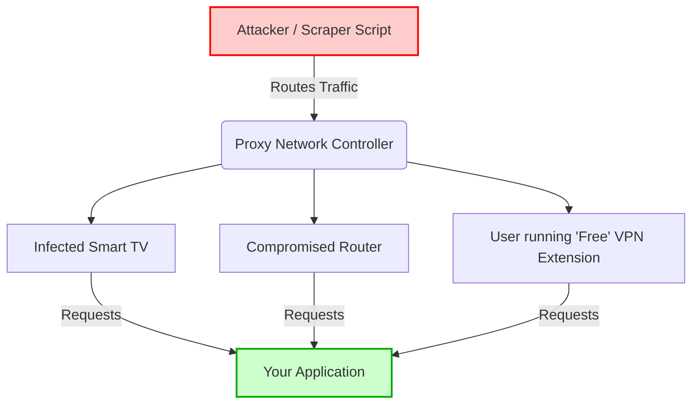

# Combating Residential Proxies and VPNs in Modern Applications

Protecting modern web applications requires significantly more than just checking an IP address against a static blocklist. Attackers constantly evolve their techniques. They leverage residential proxies and commercial VPN networks to mask their true origin and bypass rate limits. 

The security industry faces a continuous and escalating challenge. Traditional security layers struggle to differentiate between a legitimate user logging in from their home internet and an automated script routing traffic through a compromised residential proxy network. This comprehensive guide explores the mechanics of residential proxies, the economics driving their use, and the technical strategies you must implement to defend your infrastructure.

::note
A residential proxy routes traffic through an actual residential internet connection. This makes the traffic appear as though it originates from a standard home user rather than a datacenter, effectively bypassing traditional IP-based filtering.
::

## The Anatomy of the Threat Landscape

To effectively defend against a threat, you must first understand how it operates at a fundamental level. The proxy ecosystem is vast, complex, and highly commercialized.

### Types of IP Addresses Used by Attackers

Attackers utilize several categories of IP addresses, each with distinct characteristics and risk profiles:

1. **Datacenter IPs**: These are IP addresses assigned to massive server farms and cloud providers like AWS, Google Cloud, DigitalOcean, and Hetzner. They are cheap, fast, and highly available. However, they are also incredibly easy to detect and block. Legitimate consumers rarely browse the web from an AWS data center.
2. **Commercial VPNs**: Services like NordVPN, ExpressVPN, and ProtonVPN route user traffic through shared egress IPs. While often used by privacy-conscious individuals, attackers heavily abuse them to mask their geographic location and true identity.
3. **Residential Proxies**: These IPs belong to standard Internet Service Providers (ISPs) like Comcast, AT&T, and BT. They are attached to actual residential homes. Traffic originating from these IPs carries an inherently high reputation.
4. **Mobile Proxies**: Similar to residential proxies, but the IPs belong to cellular carriers (e.g., Verizon, T-Mobile, Vodafone). These are the most difficult to block because thousands of legitimate users often share a single mobile IP via Carrier-Grade NAT (CGNAT).

### How Residential Proxy Networks are Built

Understanding how attackers acquire residential IPs is critical. They do not purchase these directly from ISPs. Instead, residential proxy networks are formed through various methods, many of which reside in an ethical gray area or are outright illegal.

Some networks operate legitimately by offering users free software or premium features in exchange for sharing their idle bandwidth. Users agree to the terms of service, effectively turning their home router or computer into an exit node for the proxy network.

However, many residential proxy networks are botnets built via malware. Attackers infect thousands of IoT devices, smart TVs, home routers, and personal computers. They then sell access to this compromised network to other malicious actors on the dark web or through shady proxy reselling platforms.



## The Economic Incentives

Why do attackers go through the trouble and expense of using residential proxies? The answer lies in the massive return on investment (ROI) available in digital fraud.

### Account Takeover (ATO) and Credential Stuffing

Attackers purchase massive databases of leaked usernames and passwords. They write scripts to test these credentials against your login endpoints. If they use a single datacenter IP, your rate-limiting rules block them after a few dozen attempts. By routing the requests through thousands of residential proxies, they stay under the rate-limit thresholds and blend in with regular login traffic.

### E-commerce Scalping and Inventory Hoarding

When highly anticipated products drop—such as limited-edition sneakers, concert tickets, or next-generation gaming consoles—scalping bots swarm the site. They use residential proxies to bypass per-IP purchase limits. Scalpers can generate millions of dollars in secondary market profits, easily justifying the cost of premium residential proxy subscriptions.

### Payment Fraud and Carding

Attackers use stolen credit card information to purchase digital goods or physical items. They use residential proxies located in the same city or zip code as the stolen credit card's billing address. This geographic consistency easily bypasses simplistic fraud detection systems that flag long-distance mismatches.

::warning
Blocking entire ISPs or geographic regions to stop these attacks often leads to unacceptable false positive rates. You lock out genuine customers while attempting to stop a handful of malicious actors.
::

## Utilizing Deep Network Intelligence

IP Shield resolves this challenge by providing deep network intelligence on every request. The platform analyzes the IP address and returns a comprehensive metadata payload. This includes VPN detection flags, proxy network associations, Tor exit node identification, and precise ASN details.

You use this intelligence to introduce adaptive friction into your user flows. Rather than outright blocking an IP, you challenge high-risk connections with a CAPTCHA, require multi-factor authentication (MFA), or flag the account for manual review.

### The Role of the Autonomous System Number (ASN)

The Internet is a network of networks. An Autonomous System (AS) is a large network or group of networks that has a unified routing policy. Every AS is assigned an Autonomous System Number (ASN). 

By evaluating the ASN, you determine the organization responsible for the IP address. If the ASN belongs to a known consumer ISP like "Comcast Cable Communications," the traffic is likely residential. If the ASN belongs to "DigitalOcean, LLC," the traffic is from a datacenter.

IP Shield provides the ASN data instantly. You filter traffic based on the network type. For example, you easily block all traffic originating from hosting providers on your consumer-facing login routes, while allowing cellular and residential networks to pass unhindered.

## Implementing the Defense in Code

Defending against residential proxies demands a dynamic security posture. You must integrate real-time intelligence into your edge compute layer or application backend. By doing so, you automatically filter out the noise and focus your resources on serving legitimate users.

### Nuxt 3 and h3 Implementation

If you are using the modern Nuxt 3 stack, you integrate the IP Shield Network API directly into your server API routes or middleware. You evaluate the IP address before processing sensitive actions like logins, registrations, or checkouts.

Here is an extensive example of how you build a robust, production-ready login handler using Nuxt 3, handling edge cases, proxy headers, and implementing adaptive friction.

~~~typescript [server/api/login.post.ts]
import { IPShield } from '@ip-shield/sdk';
import { sendError, setResponseStatus, createError } from 'h3';

// Initialize the IP Shield SDK with your secure API key
const shield = new IPShield(process.env.IP_SHIELD_API_KEY);

export default defineEventHandler(async (event) => {
  // 1. Safely extract the client IP address
  // When behind a CDN or Load Balancer (Cloudflare, AWS ALB), the direct 
  // connection IP belongs to the CDN. We must inspect the X-Forwarded-For header.
  const ip = getRequestIP(event, { xForwardedFor: true });
  
  if (!ip) {
    throw createError({
      statusCode: 400,
      statusMessage: 'Unable to determine client IP address'
    });
  }

  const body = await readBody(event);
  
  // 2. Perform the IP Intelligence Lookup
  // We use a try-catch block to ensure that if the IP Shield API is unreachable 
  // due to network issues, we fail open or handle it gracefully rather than 
  // blocking all user logins.
  let networkData;
  try {
    networkData = await shield.network.lookup(ip);
  } catch (err) {
    console.error('IP Shield lookup failed, failing open for availability', err);
    // Proceed with standard authentication, but log the failure
    return authenticateUser(body.email, body.password);
  }
  
  // 3. Analyze the Threat Vectors
  const isHighRisk = networkData.isProxy || networkData.isVpn || networkData.isTor;
  const isDatacenter = networkData.asn.type === 'hosting';
  
  // 4. Execute the Security Policy
  if (networkData.isTor) {
    // Tor traffic is almost exclusively malicious in an e-commerce context.
    // We block it outright.
    setResponseStatus(event, 403);
    return { 
      error: 'access_denied', 
      message: 'Connections from the Tor network are not permitted.' 
    };
  }

  if (isDatacenter) {
    // Legitimate users do not log in from AWS servers. This is likely a script.
    setResponseStatus(event, 403);
    return { 
      error: 'access_denied', 
      message: 'Datacenter IP ranges are not permitted. Please disable your VPN.' 
    };
  }

  if (isHighRisk) {
    // The IP belongs to a residential proxy or commercial VPN. 
    // It might be a malicious actor, or it might be a privacy-conscious user.
    // We do NOT block them outright. Instead, we introduce adaptive friction.
    setResponseStatus(event, 401);
    return { 
      error: 'verification_required', 
      challengeType: 'mfa',
      message: 'Unusual network detected. Please enter the code sent to your mobile device.' 
    };
  }
  
  // 5. If all checks pass, proceed with standard authentication
  const authResult = await authenticateUser(body.email, body.password);
  
  if (!authResult.success) {
    // Even if the IP is safe, standard credential checks still apply
    throw createError({
      statusCode: 401,
      statusMessage: 'Invalid credentials'
    });
  }

  return {
    success: true,
    token: authResult.token,
    user: authResult.user
  };
});
~~~

::tip
Always test your IP extraction logic thoroughly. Misconfiguring the `x-forwarded-for` header parsing can lead to IP spoofing vulnerabilities, where an attacker injects a fake IP address to bypass your security checks.
::

### Express.js Implementation

If your backend is built on traditional Express.js, the concepts remain identical, though the implementation syntax differs slightly. You implement this as a reusable middleware function that you attach to specific high-risk routes.

~~~javascript [middleware/ipIntelligence.js]
const { IPShield } = require('@ip-shield/sdk');
const shield = new IPShield(process.env.IP_SHIELD_API_KEY);

/**
 * Express middleware to evaluate IP risk before processing requests
 */
async function ipIntelligenceMiddleware(req, res, next) {
  // Extract IP, respecting trust proxy settings in Express
  const ip = req.ip;

  try {
    const networkData = await shield.network.lookup(ip);
    
    // Attach the intelligence data to the request object for downstream use
    req.ipIntelligence = networkData;

    // Hard block for Tor and Datacenters
    if (networkData.isTor || networkData.asn.type === 'hosting') {
      return res.status(403).json({
        error: 'Forbidden',
        message: 'Your network type is not permitted to access this resource.'
      });
    }

    // Flag for downstream adaptive friction
    if (networkData.isProxy || networkData.isVpn) {
      req.requiresMfa = true;
    }

    next();
  } catch (error) {
    console.error('IP Shield API Error:', error);
    // Fail open to prevent locking out legitimate users during an outage
    next();
  }
}

module.exports = ipIntelligenceMiddleware;
~~~

You then apply this middleware to your sensitive routes:

~~~javascript [routes/auth.js]
const express = require('express');
const router = express.Router();
const ipIntelligence = require('../middleware/ipIntelligence');

// Apply the IP intelligence middleware specifically to the login route
router.post('/login', ipIntelligence, async (req, res) => {
  const { email, password } = req.body;

  // Check if the middleware flagged this request for MFA
  if (req.requiresMfa) {
    return res.status(401).json({
      error: 'MFA_REQUIRED',
      message: 'Please complete multi-factor authentication.'
    });
  }

  // Standard login logic...
  res.json({ success: true });
});

module.exports = router;
~~~

### Implementing at the Edge with Cloudflare Workers

For maximum performance, you move your security logic as close to the user as possible. Cloudflare Workers allow you to intercept requests at the CDN edge, before they ever reach your origin server. This protects your backend infrastructure from the computational load of processing malicious requests.

~~~javascript [worker.js]
export default {
  async fetch(request, env, ctx) {
    const url = new URL(request.url);
    
    // Only run the heavy IP check on sensitive endpoints to save costs and latency
    if (url.pathname !== '/api/v1/login' && url.pathname !== '/api/v1/checkout') {
      return fetch(request);
    }

    // Cloudflare provides the client IP in the headers
    const clientIP = request.headers.get('CF-Connecting-IP');

    try {
      // Make a subrequest to the IP Shield API
      const shieldResponse = await fetch(`https://api.ip-shield.riavzon.com/v1/network/${clientIP}`, {
        headers: {
          'Authorization': `Bearer ${env.IP_SHIELD_API_KEY}`
        }
      });

      if (shieldResponse.ok) {
        const networkData = await shieldResponse.json();

        // Implement blocking logic at the edge
        if (networkData.isTor || networkData.asn.type === 'hosting') {
          return new Response(JSON.stringify({ error: 'Access Denied' }), {
            status: 403,
            headers: { 'Content-Type': 'application/json' }
          });
        }
        
        // Pass intelligence data to the origin server via custom headers
        const modifiedRequest = new Request(request);
        if (networkData.isProxy || networkData.isVpn) {
          modifiedRequest.headers.set('X-Requires-Adaptive-Friction', 'true');
        }
        
        return fetch(modifiedRequest);
      }
    } catch (err) {
      // Fail open on error
      console.error('Edge security check failed:', err);
    }

    return fetch(request);
  }
};
~~~

::important
When implementing edge security, always ensure your origin server is configured to ONLY accept traffic from your Edge provider (e.g., Cloudflare IP ranges). Otherwise, attackers simply bypass the edge worker by connecting to your origin IP directly.
::

## The Challenge of IPv6 and Subnet Hopping

As the internet transitions to IPv6, attackers gain access to an unimaginably large address space. Traditional IPv4 blocklists fail against IPv6 because an attacker can cycle through billions of IP addresses within a single `/64` subnet.

When dealing with IPv6, you must adjust your defensive strategies. You no longer block or evaluate individual `/128` IP addresses. Instead, you apply your logic to the entire `/64` subnet. IP Shield handles this complexity automatically, aggregating intelligence across IPv6 blocks so that if an attacker hops IPs within their assigned subnet, the threat score remains accurate.

### Subnet Aggregation Strategies

1. **IPv4**: Track and evaluate on a `/32` (individual IP) or `/24` (C-class subnet) basis.
2. **IPv6**: Always track and evaluate on a minimum of a `/64` basis.

If you observe malicious activity from `2001:db8:1234:5678:90ab:cdef:0123:4567`, you should apply security friction to the entire `2001:db8:1234:5678::/64` range.

## Advanced Techniques: Correlating Signals

IP intelligence is incredibly powerful, but it becomes exponentially more effective when combined with other security signals. To build a truly resilient system against advanced residential proxies, you must correlate network data with client-side telemetry.

### Device Fingerprinting

Attackers using residential proxies often route traffic from hundreds of IPs, but they might use the same underlying hardware or scraping script for all requests. By implementing device fingerprinting—analyzing the Canvas API rendering, WebGL drivers, audio context, and font stacks—you generate a unique identifier for the machine making the request.

If you observe 500 different residential IPs logging into 500 different accounts, but all 500 requests share the exact same highly unique device fingerprint, you definitively identify an ongoing attack.

### Behavioral Biometrics

How does the user interact with the page? Does the mouse move in perfectly straight lines? Are keystrokes registering with zero variance in timing? Human behavior is messy and unpredictable. Scrapers and bots, even those using residential proxies, often exhibit robotic perfection.

By combining IP Shield's network data with behavioral biometrics, you achieve unprecedented detection accuracy.

## Creating a Splunk Dashboard for Traffic Analysis

Monitoring your traffic is just as important as blocking it. By logging the IP Shield metadata alongside your standard access logs, you create powerful visualizations in tools like Splunk, ELK (Elasticsearch, Logstash, Kibana), or Datadog.

Here is an example Splunk SPL query to identify the top ASNs associated with failed login attempts:

```spl
index=production sourcetype=api_logs endpoint="/api/v1/login" status=401
| stats count by ip_intelligence.asn.name, ip_intelligence.asn.type
| sort - count
| head 20
```

This query instantly reveals if a specific datacenter or proxy network is currently targeting your authentication endpoints, allowing your security team to respond proactively.

## Conclusion

The era of simple IP blocking is over. The commoditization of residential proxy networks has fundamentally shifted the balance of power, granting attackers the ability to blend seamlessly into legitimate user traffic.

To survive in this environment, your applications must become contextually aware. By integrating deep network intelligence from tools like IP Shield into your authentication flows, edge routers, and monitoring dashboards, you regain visibility. You transition from a static, reactive security posture to a dynamic, adaptive defense capable of thwarting the most sophisticated modern attacks.

Security is not a final destination; it is a continuous arms race. Equip your infrastructure with the intelligence it needs to win.
