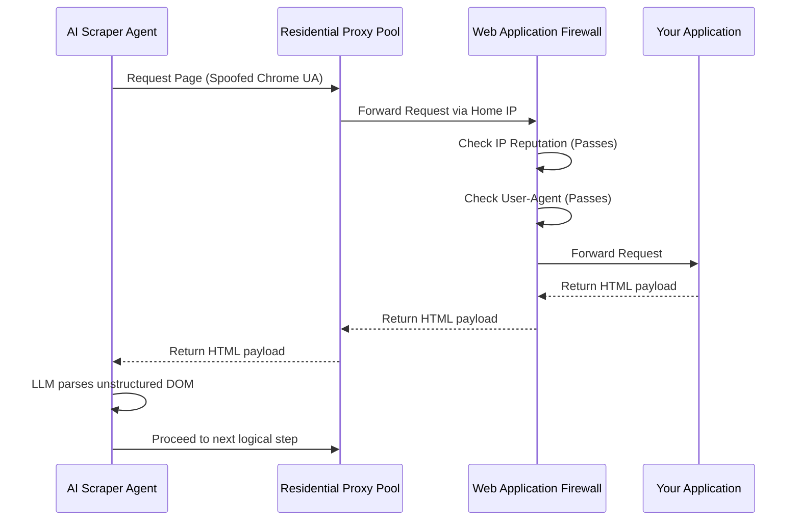

# The Evolution of Bot Management and User Agent Parsing

Bot traffic comprises nearly half of all internet traffic today. While some bots index your content for search engines, others scrape your proprietary data, scalp your inventory, probe your applications for vulnerabilities, or consume massive amounts of your bandwidth. Managing this traffic effectively determines the performance, cost-efficiency, and security of your digital infrastructure.

In the early days of the web, bot management was incredibly straightforward. It meant reading the `User-Agent` HTTP header. Developers simply wrote regular expressions to block strings containing `python-requests`, `curl`, or `Java/1.8.0`. Today, malicious actors spoof their headers to perfectly mimic Chrome running on a macOS device, rendering naive string matching obsolete.

This comprehensive guide explores the multi-generational evolution of bot architecture, why legacy detection mechanisms fail, and how to implement modern, context-aware bot mitigation strategies using IP Shield and advanced server-side architectures.

::note
A User-Agent string identifies the client software originating the request. Because the client controls this header entirely, it provides no inherent cryptographic proof of identity. Relying on it for security is equivalent to trusting a visitor's handwritten name tag.
::

## The Generations of Web Scraping

To understand how to defeat modern bots, we must trace their evolutionary history. As defensive mechanisms improved, scraper technology evolved in direct response, creating a fascinating arms race.

### Generation 1: The Scripted Clients
The earliest bots were simple HTTP clients. Tools like `cURL`, `wget`, and libraries like `urllib` or `python-requests` made bare-bones HTTP GET and POST requests. They were extremely fast and efficient but completely incapable of executing JavaScript. If a website rendered content client-side via React or Angular, Generation 1 bots failed entirely. They were also easily detected by their default User-Agent strings.

### Generation 2: The Early Headless Browsers
As the web moved towards Single Page Applications (SPAs), bots needed to execute JavaScript. Projects like PhantomJS emerged, providing a scriptable, headless WebKit engine. While they could render JS, they leaked massive amounts of identifiable information. Security tools easily detected them by checking for variables like `window._phantom` or analyzing their unique TLS fingerprint.

### Generation 3: The Modern Headless Era
Today, attackers utilize headless versions of modern browsers controlled via frameworks like Puppeteer, Playwright, and Selenium. These tools execute JavaScript, solve simple CAPTCHAs, and mimic human interaction patterns perfectly. Furthermore, developers have created "stealth" plugins (e.g., `puppeteer-extra-plugin-stealth`) designed specifically to patch the JavaScript variables and inconsistencies that anti-bot software looks for. They render pages just like a real user, making detection incredibly difficult at the application layer.

### Generation 4: AI Agents and Distributed Scrapers
We are currently entering the fourth generation. Bots are no longer simple scripts; they are AI-driven agents powered by Large Language Models (LLMs) that can navigate complex dynamic UIs, understand semantic page layouts, and dynamically adjust their scraping strategies when website structures change. When an attacker pairs these AI agents with a rotating residential proxy network, the traffic looks indistinguishable from organic human user growth.

::warning
Relying solely on User-Agent parsing to block bots leaves your application completely exposed to modern headless scraping frameworks and AI agents. You must look beyond the header.
::

## Verifying Legitimate Bots: The SEO Dilemma

Not all automated traffic is harmful. Search engine crawlers like Googlebot, Bingbot, Yandex, and specialized SEO tools (Ahrefs, Semrush) must access your site to ensure your business remains visible online. You cannot afford to block them accidentally with overly aggressive anti-bot rules; doing so destroys your organic search rankings.

However, malicious scrapers frequently spoof the `Googlebot` User-Agent string to bypass security filters. They know that naive WAF configurations include rules like: `IF User-Agent CONTAINS "Googlebot" THEN ALLOW`. 

You must verify that the bot claiming to be Google actually originates from an IP address owned by Google. This requires cross-referencing the claimed identity with the underlying network infrastructure.

### The Verification Process: Reverse DNS

The traditional way to verify a search engine crawler is performing a Reverse DNS (rDNS) lookup followed by a Forward DNS lookup.

1. **Reverse DNS Lookup**: You query the DNS pointer (PTR) record of the incoming IP address. For example, doing an rDNS lookup on `66.249.66.1` returns `crawl-66-249-66-1.googlebot.com`.
2. **Domain Verification**: You verify that the domain ends in `googlebot.com` or `google.com`.
3. **Forward DNS Lookup**: To prevent an attacker from simply setting up a fake PTR record on their own server, you must do a forward DNS lookup on the domain returned in step 1 (`crawl-66-249-66-1.googlebot.com`).
4. **Final Match**: If the IP returned in step 3 matches the original IP `66.249.66.1`, the crawler is verified.

Performing this three-step DNS dance for every single incoming request introduces massive latency to your application. It is computationally expensive and slow.

### The Modern Solution: IP Shield Bot API

IP Shield simplifies this verification process dramatically. The User Agent & Bot Parser API analyzes the header string and automatically performs the reverse DNS lookups, ASN verification, and signature matching in real-time. It explicitly flags whether a known crawler is verified or spoofed.

You implement this check in your edge routing layer or middleware. This ensures fake crawlers get dropped before they consume your application resources, while legitimate SEO bots pass through smoothly.

## Implementing Bot Protection Middleware

Here is a comprehensive example of verifying search engine crawlers and blocking malicious bots using a Nuxt 3 server middleware. This implementation handles rate limiting, safe-listing, spoof detection, and adaptive responses.

~~~typescript [server/middleware/bot-protection.ts]
import { IPShield } from '@ip-shield/sdk';
import { sendError, setResponseStatus, createError } from 'h3';

// Initialize the SDK
const shield = new IPShield(process.env.IP_SHIELD_API_KEY);

// Cache verified IPs in memory to reduce API calls and latency
// In production, use Redis or unstorage for distributed caching
const verifiedBotCache = new Set<string>();

export default defineEventHandler(async (event) => {
  // Extract essential request metadata
  const ip = getRequestIP(event, { xForwardedFor: true }) || '';
  const userAgent = getRequestHeader(event, 'user-agent') || '';
  const path = event.path;
  
  // Skip static assets to save compute resources
  if (path.startsWith('/_nuxt/') || path.match(/\.(js|css|png|jpg|svg|ico)$/)) {
    return;
  }

  // Fast path: if we've already verified this IP recently, let it through
  if (verifiedBotCache.has(ip)) {
    return;
  }
  
  try {
    // Cross-reference the IP and User-Agent with IP Shield
    const botData = await shield.bots.analyze({ ip, userAgent });
    
    // Scenario 1: The request claims to be a good bot but the IP doesn't match
    if (botData.isBot && botData.isSpoofed) {
      console.warn(`Spoofed bot detected from IP: ${ip} claiming to be: ${userAgent}`);
      
      // We drop spoofed bots immediately with a 403 Forbidden.
      setResponseStatus(event, 403);
      return { 
        error: 'spoofed_identity_detected',
        message: 'Your network origin does not match your claimed identity.'
      };
    }
    
    // Scenario 2: It is a verified, legitimate search engine crawler
    if (botData.isVerifiedCrawler) {
      // Cache the IP to speed up subsequent requests from this crawler
      verifiedBotCache.add(ip);
      
      // Optionally limit the cache size to prevent memory leaks
      if (verifiedBotCache.size > 10000) verifiedBotCache.clear();
      
      return; // Allow the request to proceed
    }
    
    // Scenario 3: It is an unverified, generic scraper script (e.g., python-requests)
    // We don't want these consuming our server rendering resources.
    if (botData.isBot && !botData.isVerifiedCrawler) {
      setResponseStatus(event, 429);
      return { 
        error: 'automated_traffic_blocked',
        message: 'Automated access is restricted. Please use our official API.'
      };
    }

    // Scenario 4: It appears to be a legitimate human user.
    // Proceed to the next middleware or route handler.
    return;
    
  } catch (err) {
    // Fail open: if the IP Shield API is down, we don't want to block organic traffic
    console.error('Bot analysis failed:', err);
    return;
  }
});
~~~

::important
Always deploy bot protection logic as early in the request lifecycle as possible. Blocking requests at the edge or middleware layer prevents expensive database queries, business logic execution, and Server-Side Rendering (SSR) cycles from running unnecessarily.
::

## Advanced Implementations: Python FastAPI

For data science teams or Python-heavy backends, integrating IP Shield into FastAPI is highly effective for protecting API endpoints from scrapers.

~~~python [app/dependencies/bot_protection.py]
from fastapi import Request, HTTPException, status
import httpx
import os

IP_SHIELD_API_KEY = os.getenv("IP_SHIELD_API_KEY")

async def verify_bot_traffic(request: Request):
    """
    FastAPI dependency to intercept and analyze incoming traffic.
    """
    client_ip = request.client.host
    user_agent = request.headers.get('user-agent', '')
    
    # Handle proxy headers if behind an ingress controller
    forwarded_for = request.headers.get('x-forwarded-for')
    if forwarded_for:
        client_ip = forwarded_for.split(',')[0].strip()

    async with httpx.AsyncClient() as client:
        try:
            response = await client.post(
                "https://ip-shield.riavzon.com/v1/check/bot",
                json={"ip": client_ip, "userAgent": user_agent},
                headers={"Authorization": f"Bearer {IP_SHIELD_API_KEY}"},
                timeout=2.0
            )
            
            if response.status_code == 200:
                data = response.json()
                
                if data.get("isSpoofed"):
                    raise HTTPException(
                        status_code=status.HTTP_403_FORBIDDEN,
                        detail="Spoofed User-Agent identity detected."
                    )
                    
                if data.get("isBot") and not data.get("isVerifiedCrawler"):
                    raise HTTPException(
                        status_code=status.HTTP_429_TOO_MANY_REQUESTS,
                        detail="Automated access restricted."
                    )
                    
        except httpx.RequestError as exc:
            # Fail open on timeout or network error
            print(f"IP Shield validation error: {exc}")
            pass
            
    return True
~~~

You then inject this dependency into your highly targeted routes:

~~~python [app/main.py]
from fastapi import FastAPI, Depends
from app.dependencies.bot_protection import verify_bot_traffic

app = FastAPI()

@app.get("/api/v1/sensitive-data", dependencies=[Depends(verify_bot_traffic)])
async def get_sensitive_data():
    return {"data": "This data is protected from unauthorized scrapers."}
~~~

## Handling False Positives with Adaptive Friction

No detection system is perfect. Occasionally, a legitimate user might be using a niche browser extension, a privacy-focused corporate VPN, or an outdated operating system that triggers a high bot-probability score. 

If you institute a hard block (returning a 403 Forbidden page), you permanently lose that user. The modern approach utilizes **Adaptive Friction**.

When a request's threat score falls into a "gray area" (e.g., highly suspicious, but not definitively proven to be a malicious script), you intercept the request and present a challenge.

### Types of Adaptive Challenges:

1. **Visual CAPTCHAs**: The traditional approach (reCAPTCHA, hCaptcha). Effective, but heavily degrades the user experience and lowers conversion rates.
2. **Proof of Work (PoW)**: Your server sends a cryptographic puzzle to the client's browser. The browser must spend a few seconds of CPU time computing the hash before it is allowed to proceed. Legitimate users barely notice the slight delay, but an attacker trying to scrape 10,000 pages per minute finds their operation crippled by CPU costs.
3. **JavaScript Execution Challenges**: The server returns an obfuscated JavaScript payload that must execute and return a specific token. Since Generation 1 bots (like `cURL`) cannot execute JavaScript, they fail immediately without bothering human users.

## Conclusion

Effective bot management requires looking at the holistic picture. You analyze the IP reputation, the ASN, the behavioral patterns, the reverse DNS records, and the HTTP headers collectively. IP Shield aggregates these vast, complex signals into a unified threat intelligence layer.

This unified approach allows you to set dynamic, highly granular thresholds. You block requests with a definitive spoofing flag outright, challenge suspicious gray-area requests with invisible Proof of Work puzzles, and allow verified SEO traffic seamless, accelerated access. 

The evolution of bot management has moved definitively away from static string-matching rules. To protect modern infrastructure, engineering teams must embrace dynamic, context-aware intelligence networks.
